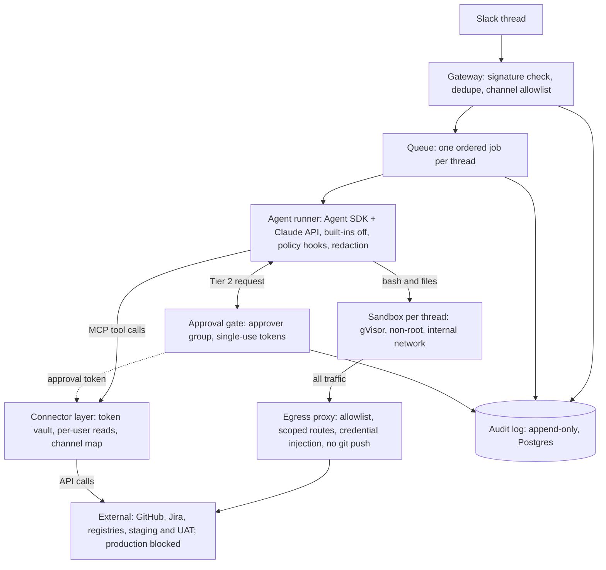

# Architecture

Status: **target architecture** as of Phase 0. Phase 0 builds only the config loader, logging and local services; everything else lands in the phase named in the tables below. Open choices are decisions D-001 to D-008 in [decisions.md](decisions.md).

## The rule the design follows

The model can only ask. Writes and credentials are enforced at boundaries the model cannot argue its way past: the sandbox, the egress proxy, the connector layer and the approval gate. Parsing what the model writes (the command classifier) is an early warning, never the control.

## Topology

## Components

| Component           | Code                             | Responsibility                                                               | Enforcement role                                                         | Phase         |
| ------------------- | -------------------------------- | ---------------------------------------------------------------------------- | ------------------------------------------------------------------------ | ------------- |
| Gateway             | `src/gateway/`                   | Slack events in, replies out; signature check, dedupe, 3-second ack, enqueue | Rejects forged or replayed requests; channel allowlist                   | 1             |
| Authorization       | `src/authz/`                     | Channel-to-project map, requester access, approver groups                    | Confused-deputy prevention                                               | 1, 3, 5       |
| Queue               | `src/queue/`                     | BullMQ jobs, one run per thread, run state, thread lock                      | Ordering; no two runs touch one workspace                                | 1, 5          |
| Agent runner        | `src/agent/`                     | Agent SDK loop, budgets, progress messages                                   | Built-in tools off; budgets; redaction before the model                  | 1             |
| Sandbox             | `src/sandbox/`, `sandbox-image/` | Per-thread container with shell, files and Playwright                        | Isolation: gVisor, non-root, no caps, read-only root, limits             | 2             |
| Egress proxy        | `src/egress/`                    | The sandbox's only route out                                                 | Allowlist, DNS, credential injection, route scoping, blocked-request log | 2, 3          |
| Connector layer     | `src/mcp/`                       | MCP servers for GitHub and Jira, token vault, trace scrubbing                | Tokens never leave it; writes need approval tokens                       | 3, 5          |
| Redaction           | `src/redaction/`                 | Secrets and PII out of tool output, audit rows and Slack posts               | Data-loss prevention                                                     | 3             |
| Policy              | `src/policy/`                    | Tier table and command classifier                                            | Early warning and UX only                                                | 5             |
| Approval gate       | `src/approvals/`                 | Block Kit approvals, single-use tokens, suspend and resume                   | Human-in-the-loop for Tier 2                                             | 5             |
| Audit               | `src/audit/`                     | Append-only record of every prompt, tool call, command, approval and cost    | Attribution; fail closed when unavailable                                | 1, 5          |
| QA skills           | `src/qa/`                        | Triage, test generation, healing, test data, release readiness               | Diff guard, assertion lint                                               | 4, 6          |
| Triggers and memory | `src/triggers/`, `src/memory/`   | Webhooks, schedules, kill switch, approved notes                             | Same tiers as human-triggered runs                                       | 7             |
| Config and logging  | `src/config/`, `src/shared/`     | Validated env, JSON logs with correlation ids                                | Secrets never in config errors or logs                                   | **0 (built)** |

## Request path

1. A user mentions the bot in an allowlisted channel. The gateway verifies the Slack signature and timestamp, drops duplicates, acks within 3 seconds, and enqueues a job keyed by `channel + thread_ts`. The Slack event id becomes the correlation id for every log line in the run.
2. The queue gives each thread one run at a time. A run waiting for approval keeps the thread lock but frees its worker.
3. The agent runner builds the prompt from the thread (each message tagged with its author, all of it untrusted) and runs the Agent SDK loop with only our registered tools.
4. Tool calls go to the sandbox (shell and files) or the connector layer (GitHub and Jira). Their output is redacted before the model sees it.
5. The sandbox reaches the outside world only through the egress proxy. Credentialed routes (git fetch, registry reads) are plain HTTP to the proxy, which adds credentials upstream. Staging and companion hosts are allowlisted by hostname.
6. A Tier 2 action (PR, ticket, comment, shared test data) pauses the run and posts an approval rendered from the raw arguments. The approver's click mints a single-use token bound to that exact payload, and the connector layer refuses the write without it.
7. The final answer is redacted and posted in the thread. Every step above writes an audit row; if the audit store is down, the run stops.

## Where things live

| Process            | Runs                                                                            | Holds secrets                               |
| ------------------ | ------------------------------------------------------------------------------- | ------------------------------------------- |
| Gateway            | Slack connection, approval button handling                                      | Slack signing secret, bot token             |
| Worker             | Queue consumer and agent runner (the Agent SDK subprocess runs here, per D-001) | Claude API key                              |
| Connector service  | MCP servers, token vault, trace scrubbing                                       | GitHub and Jira tokens                      |
| Egress proxy       | Allowlist, credential injection, request log                                    | Git and registry credentials                |
| Sandbox containers | The agent's computer, one per thread                                            | **None**                                    |
| Redis              | Queue and thread locks                                                          | None (job payloads hold ids, not content)   |
| Postgres           | Audit log, run state, session metadata                                          | Audit content (redacted), encrypted at rest |

## Trust boundaries

Listed in [threat-model.md](threat-model.md#trust-boundaries). The two that carry the most weight: the sandbox boundary (everything inside it may be attacker-influenced) and the egress proxy (the only path from attacker-influenced code to the network).
