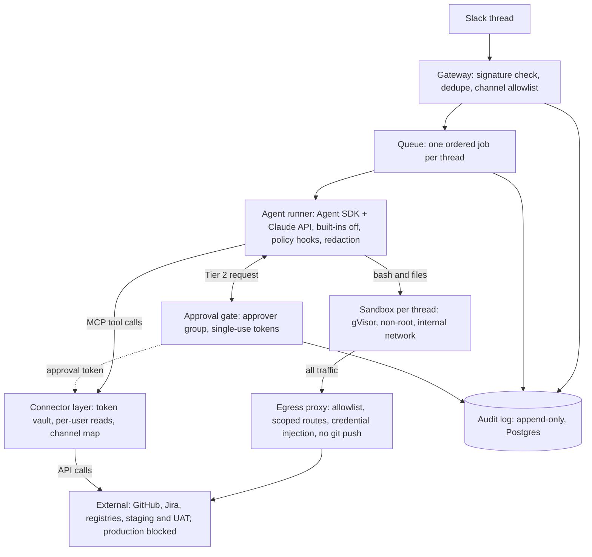

# Build brief v2.2: chat-triggered QA agent

Oct 25, 2026 · @Abdul Hameed

## Mission

You are a senior engineer building a chat-triggered autonomous agent for enterprise test automation. A user @mentions the bot in Slack. The bot runs a Claude-powered agent loop inside a per-thread, isolated sandbox ("its own computer"), uses connectors such as GitHub and Jira via MCP, and replies in the thread. Risky actions require human approval.

The first real use case is QA failure triage, piloted read-only in Phase 4. Test generation, locator healing, test data on demand and release readiness follow in Phase 6.

v2 changes the build order. Read-only connectors and the triage pilot come before the approval system, and every write tool stays denied until approvals exist. The full list is in "Changes from v1" at the end.

## Working agreement (read first)

1. Build strictly phase by phase. Each phase has a goal, deliverables, acceptance criteria and a gate. Do not start the next phase until the current gate passes and I say "proceed".
2. At the start of each phase, post a short plan: the files you'll touch and the risks. Then build.
3. At the end of each phase, post what was built, how to run it, test results, known gaps, and the decisions I should review.
4. Verify current docs before using any SDK or API. Do not rely on memory for the Claude Agent SDK, MCP SDK, Slack Bolt, BullMQ, dockerode, gVisor or Playwright. Pin versions in `package.json`.
5. Ask me only when a decision is irreversible or changes scope. Otherwise pick the sensible default, record it in `docs/decisions.md`, and continue.
6. The decisions listed under Phase 0 are mine to approve. Propose an answer for each, but do not build on one until I approve it at the Phase 0 gate.
7. Every phase ships with automated tests, a README section, and no secrets in the repo.
8. Keep commits small with clear messages. Never commit `.env`.
9. When a requirement here turns out to be wrong or impossible (for example, a hardening flag that breaks Chromium), stop and record the conflict. Do not quietly weaken a security control to make something work.

## Stack

These are defaults. Change one only with a reason recorded in `docs/decisions.md`.

| Area | Default |
| --- | --- |
| Language and runtime | TypeScript (strict), Node 22, pnpm, ESM |
| Agent loop | Claude Agent SDK (TypeScript), with its built-in shell and file tools disabled |
| Chat surface | Slack Bolt for JS. Socket Mode for dev; HTTP or Socket Mode for prod is a Phase 0 decision |
| Queue | BullMQ + Redis |
| Sandboxes | Docker via dockerode, gVisor (`runsc`) runtime where the host supports it, behind a `SandboxProvider` interface so Firecracker or a hosted sandbox can replace it |
| Egress | Allowlisting forward proxy as the sandbox's only route out |
| Storage | Postgres for audit log and session metadata (SQLite acceptable in Phases 1–2) |
| Connectors | MCP TypeScript SDK |
| Test execution | Playwright, inside the sandbox image |
| Testing and validation | Vitest, Zod |
| Logging | pino, with a correlation id per request |
| Local dev | docker-compose |

## Target architecture

_(The drawn diagram lives in the source doc. The Mermaid block below is the same topology.)_

The model can only ask. The approval gate issues single-use tokens, and the egress proxy and connector layer refuse any write that lacks one. The sandbox's only route out is the egress proxy, and credentials are injected there or in the connector layer.

The same topology as Mermaid, for the Markdown export and `docs/architecture.md`:



## Repo layout

Compared with v1, this adds `authz/`, `egress/`, `redaction/`, `memory/`, the eval subfolders and `docs/data-handling.md`.

```text
chat-agent/
  src/
    gateway/      # Slack Bolt app, signature check, event dedupe, enqueue
    authz/        # channel-to-project map, who may invoke, approver groups
    queue/        # BullMQ producers/workers, per-thread concurrency = 1, run state
    agent/        # Agent SDK runner, prompts, hooks, custom tools (built-ins off)
    sandbox/      # SandboxProvider interface, Docker impl, lifecycle, TTL, reaper
    egress/       # allowlisting proxy, credential injection, request log
    policy/       # tier table, command classifier (early warning), enforcement hooks
    approvals/    # Block Kit flow, approval tokens, suspend/resume, timeouts
    mcp/          # connector registry, OAuth, token vault
    redaction/    # secret and PII redaction for tool output, Slack posts, audit rows
    qa/           # QA skills: triage, test-gen, healing, TDM, release readiness
    triggers/     # signed webhooks, schedules, kill switch
    memory/       # proposed and approved project notes
    audit/        # append-only audit store, trace export
    config/       # typed env config via Zod
  sandbox-image/  # Dockerfile for the agent's computer
  evals/
    triage/       # labeled failures + rubric (started in Phase 0)
    injection/    # prompt-injection cases, one folder per vector
    test-gen/
    healing/
  docs/           # architecture, decisions, runbook, threat-model, data-handling
  docker-compose.yml
```

## Global security requirements (every phase)

Security is enforced at boundaries the model cannot argue its way past: the sandbox, the egress proxy and the connector layer. Parsing what the model writes is a warning layer, not a control.

**Untrusted input**

- Treat everything the bot reads as untrusted. That includes Slack messages (other people in the thread too), web pages, CI logs, files, Jira text, repo content, the app under test (its DOM and accessibility tree too, including aria-labels and hidden or offscreen text), and memory read back.
- None of it overrides system instructions or policy. Instructions found inside tool results are data, not commands.

**Where enforcement lives**

- Tier 2 and Tier 3 are enforced at the egress proxy and the connector layer.
- The command classifier warns early and improves the UX. It is never the only control.

**Credentials**

- The model never sees connector tokens, git credentials or registry tokens. They live in the vault and are injected at the proxy or connector boundary.
- Staging test-user credentials follow the Phase 0 credential decision. Whatever is chosen, they are low-privilege, staging-only and rotated.

**Sandboxes**

- Non-root user, no privileged mode, all capabilities dropped, a seccomp profile.
- Read-only root filesystem, with a writable workspace volume and tmpfs mounts for `/tmp`, `/dev/shm` and `HOME`. `/dev/shm` is sized explicitly (Phase 2) and counted in the memory limit.
- CPU, memory and pids limits, a hard wall-clock timeout, no Docker socket, no host mounts, no `--ipc=host`. gVisor runtime where available.
- Shared caches are served by the proxy or baked into images. A shared read-only volume is an exception that needs a decision entry.

**Network**

- Deny by default. Sandboxes sit on an internal-only network, and the egress proxy is their only route out.
- No direct IP egress and no DNS from the sandbox; the proxy resolves names.
- Allowlist per sandbox: package registries, the specific staging and UAT hosts, connector endpoints, and per-project staging companion domains (identity provider, CDN, feature flags). Each companion domain is reviewed and limited to GET where possible. Cloud metadata endpoints are always blocked.
- The proxy scopes every authenticated route by method and path. Fetch and push both use POST, so git is scoped by service path: `git-upload-pack` is allowed and `git-receive-pack` is always blocked. The sandbox never pushes. Registries are read-only. Only the repos mapped to the channel are reachable. Keeping a token out of the sandbox means little if the proxy lends out its full power.
- Production hosts are blocked. Allowing one requires a code change plus review.

**Authorization**

- The bot responds only in allowlisted channels, and each channel maps to the projects and repos it may touch.
- Reads use the requester's own access where possible (per-user OAuth). A shared service account never reads a repo the requester cannot.
- Content is posted only into channels whose members are cleared to see it.
- Approvers come from a configured group. Whether requesters can approve their own Tier 2 actions is a Phase 0 decision.

**Data handling**

- Redact secrets and PII from tool output before it reaches the model, the audit store or Slack. CI logs, traces and screenshots are the usual sources.
- Binary artifacts need their own scrubbing. A text redactor cannot see inside Playwright `trace.zip` or HAR files, so the connector scrubs them (Phase 3).
- Screenshots skip text redaction and can carry injected text. Staging uses masked or synthetic data, screenshots the agent takes mask sensitive elements, and the boundaries contain whatever an image tries to make the agent do.
- The audit log is the most sensitive store. Encrypt it at rest, restrict access, and set its retention in `docs/data-handling.md`.
- Record the model provider's data-retention terms that apply to this deployment.

**Outputs and approvals**

- Slack replies are an output channel too. They go through redaction and the channel-visibility rule.
- Approval previews are rendered from the raw tool-call arguments, never from text the model wrote.

**Attribution and fail-closed**

- Every action records who asked, in which thread, which sandbox, which command and which approval.
- From Phase 1: if the audit store is unavailable, the agent stops and says so. From Phase 5, the same holds for the policy engine and approval service.

**Cost**

- Every run has turn, token and wall-clock limits from Phase 1. Per-user and per-day budgets arrive in Phase 5.

## Phase 0: Foundations and decisions

Goal: a runnable skeleton, the decisions that shape everything after it on record, and the triage dataset started.

**Deliverables**

- Repo scaffold per the layout. Lint, format, typecheck, and a CI workflow running typecheck and tests.
- `config/` with Zod-validated env loading and a `.env.example`.
- docker-compose with Redis and Postgres.
- Structured logging with a correlation id per request.
- `docs/architecture.md` (the diagram below, in text), `docs/data-handling.md` and `docs/decisions.md`.
- `docs/threat-model.md`: assets, trust boundaries and top threats. Cover prompt injection; secret exfiltration, including through Slack replies and allowlisted hosts; sandbox escape; confused-deputy access; memory poisoning; visual prompt injection through screenshots; the egress proxy used as an authenticated oracle; approval fatigue; runaway cost; destructive commands.
- **Build-vs-buy spike** (time-boxed; two days suggested). Assess Claude Tag (Anthropic's agent in Slack) and Anthropic's Managed Agents against Phases 1–3. Deliver a one-page recommendation: what to build, what to adopt, and what `SandboxProvider` must support either way.
- **Triage dataset kickoff.** A label rubric for the five classes (product bug, flaky test, locator or selector drift, test data issue, environment or infra issue), an anonymization procedure, and the first 10 labeled failures. Two people label each failure and disagreements are recorded. Collection continues alongside later phases, with 50 labeled before the Phase 4 gate.

**Decisions to propose (I approve them at the gate)**

1. **Runner placement.** Either the runner stays outside the sandbox and calls it through custom tools, or the whole runner lives inside the sandbox. In both cases the SDK's built-in shell and file tools are disabled.
2. **Credential model.** A forward proxy cannot add headers inside an HTTPS CONNECT tunnel. Choose how git and private registries authenticate without a token entering the sandbox:
   - **URL rewriting (default).** Git `url.<base>.insteadOf` and registry URLs point at plain-HTTP routes on the egress proxy. The proxy upgrades to HTTPS and adds credentials upstream.
   - **TLS interception.** The proxy terminates TLS with an internal CA. The image must trust that CA in the system store, `NODE_EXTRA_CA_CERTS`, git's `http.sslCAInfo` and Chromium's NSS database.
   - Either way, no credential helper may return a token into the sandbox, and every route is scoped as the Network rules require.
   - Staging test users: visible to the model (login forms usually need them) or injected by the proxy.
3. **Authorization model.** The channel-to-project map, per-user OAuth or a service account for each connector, where the approver group comes from, and whether self-approval is allowed.
4. **Run semantics.** At-least-once for runs, exactly-once for side effects via idempotency keys, and what the user sees after an interrupted run.
5. **Slack transport in prod.** A public HTTP endpoint or Socket Mode.
6. **Sandbox runtime.** Whether gVisor is available on the target hosts, how Chromium runs under the hardening, and the `/dev/shm` size.
7. **Data handling.** Redaction rules, audit-log retention, and the model provider's retention terms.
8. **Warm start.** How a workspace gets a repo and its dependencies in seconds without host mounts: a registry caching proxy, a git mirror served by the proxy, per-repo prebuilt images, or a mix. It must also keep Playwright browser builds matched to each repo's Playwright version, through per-repo images, a multi-version browser cache, or the Playwright download host behind the caching proxy.

**Acceptance criteria**

- `pnpm install && pnpm test && docker compose up -d` works from a clean clone.
- CI is green.
- Every decision above has a proposed answer in `docs/decisions.md`.
- The rubric and the first labeled failures are committed to `evals/triage/`, anonymized.

**Gate:** I review the threat model, the decisions, the spike recommendation and the rubric.

## Phase 1: Gateway and agent loop (no sandbox yet)

Goal: mention the bot in an allowlisted channel and get an intelligent threaded answer.

**Deliverables**

- Slack app manifest and setup instructions: scopes, events, and Socket Mode for dev.
- Gateway: signature verification, dedupe of Slack retries and duplicate events, ack within 3 seconds, and a job enqueued keyed by `channel + thread_ts`.
- Channel allowlist from `authz/`. A mention anywhere else gets a short reply and nothing runs.
- Queue worker with strict per-thread ordering and a global concurrency limit. Messages that arrive mid-run queue behind it, and a `stop` command cancels the current run.
- Agent runner on the Agent SDK with a restrictive system prompt. The SDK's built-in tools are disabled, and no shell or file tools exist yet. Thread history is passed as context, tagged with each message's author.
- Progress shown by editing one "working…" message, throttled to stay within Slack's rate limits, then the final answer.
- Run semantics per the Phase 0 decision. If a worker dies mid-run, the job is retried or marked interrupted, never silently duplicated, and the thread is told what happened.
- Per-run budgets for turns, tokens and wall-clock time, with clear messages when one is hit.
- Audit rows for run id, user, thread, model, token usage and outcome. The agent refuses to run when the audit store is unavailable.

**Acceptance criteria**

- An integration test with fake Slack payloads proves dedupe, ordering and ack timing.
- A test proves the agent's tool list holds only the tools you registered, with no SDK built-ins.
- A mention in a channel that isn't allowlisted runs nothing.
- With the audit store down, the run is refused and the thread says why.
- Killing the worker mid-run leaves exactly one outcome in the thread: completed, or interrupted with a notice.
- Manual: a mention in a test workspace gets a threaded reply, and follow-ups in the thread keep context.

**Gate:** demo in Slack, then proceed.

## Phase 2: Sandbox per thread

Goal: the agent gets its own computer, and the network is the boundary.

**Deliverables**

- A `SandboxProvider` interface with `create`, `exec`, `readFile`, `writeFile`, `destroy` and `status`. `snapshot` is optional: define what it captures, or defer it in `docs/decisions.md`.
- A Docker implementation with the global hardening, using the gVisor runtime where available.
- `sandbox-image/Dockerfile`: Node, Python, git, Playwright browsers matched per decision 8, common CLI tools, and a non-root user. If the credential decision picks TLS interception, the image trusts the proxy's CA in every store listed in Phase 0.
- Chromium under the hardening: a `/dev/shm` tmpfs of at least 1 GB, with the memory limit raised to cover it, and a recorded approach for Chromium's own sandbox. `--ipc=host` is not allowed. Adding capabilities or `--no-sandbox` needs a decision entry first.
- Lifecycle: create lazily on first need, reuse within a thread, an idle TTL, a hard maximum lifetime, and a reaper job that cleans up after crashes.
- A persistent workspace volume per thread, with a TTL separate from the container's idle TTL. It survives container restarts and is deleted when its own TTL ends. A run waiting for approval pins its volume until the approval token expires.
- Warm start per the Phase 0 decision, so triage does not spend its wall-clock budget on a cold clone and install.
- Egress: an internal-only network, the allowlisting proxy as the only route out, DNS through the proxy only, and metadata endpoints blocked. Per-project companion allowlists live in config. Log every allowed and blocked request.
- A read-only tool that returns the current sandbox's blocked-request log, so the agent can tell a proxy block from a real failure.
- Sandbox-backed agent tools: `bash`, `read_file`, `write_file`, `list_files`. Large output is truncated with a pointer to a file, and every command has a timeout.
- Files the agent produces, such as screenshots and reports, can be uploaded to the thread under the channel-visibility rule.

**Policy in this phase:** everything inside the sandbox runs as Tier 1. The network boundary is the control, and no connector or write tools exist yet.

**Acceptance criteria**

- Escape smoke tests pass. The sandbox cannot reach the host, the Docker socket, metadata endpoints, other sandboxes, blocked domains, or the internet by raw IP. DNS queries from the sandbox fail. Nothing runs as root.
- A fork bomb and a memory hog are contained.
- A sample Playwright spec runs headless under the full hardening on a heavy page, with trace and video recording on, without Chromium crashing. A repo pinned to a different Playwright version than the image default launches its browsers without a live download.
- Two threads running at once cannot see each other's files.
- Orphaned containers are reaped within the configured TTL.
- A workspace volume outlives its container's idle TTL, and is kept while its run waits for approval.
- Workspace hydration time is reported, cold and warm, for a representative repo.

**Gate:** I review the escape-test results, the network policy and the Chromium approach.

## Phase 3: Read-only connectors, secrets proxy and redaction

Goal: GitHub and Jira reads, plus a pattern for more connectors, without exposing credentials or leaking data. No write tool exists in this phase.

**Deliverables**

- A connector registry: config-driven MCP servers with per-connector scopes and per-tool allow and deny lists. Write tools are not registered at all until Phase 5. A flag alone is not enough.
- MCP servers run outside the sandbox, unless the runner-placement decision says otherwise.
- OAuth per the authorization decision, with encrypted token storage and rotation. Tokens never enter prompts, logs, audit rows, Slack posts, or the sandbox's env or disk.
- The secrets proxy, built to the credential decision. It covers connector calls, git over HTTPS, private registries, and staging test credentials as decided. Every authenticated route is scoped by method and path, and git routes by service path: fetch only, registry reads only, and only the channel's repos.
- Authorization enforced at the connector layer. A repo outside the channel's map, or one the requester cannot access, is refused.
- GitHub read tools: read a repo, list PRs and checks, fetch CI logs, and download Playwright traces, screenshots and videos.
- Trace scrubbing. Outside the sandbox, the connector unpacks `trace.zip` and HAR files and strips cookies, auth headers and sensitive response bodies from the network data. It also runs the redactor over the action logs and DOM snapshots, where typed form values are recorded, including exact-match redaction of staging credentials held in the vault. Only then does it write them to the workspace.
- Jira read tools: read an issue and search.
- A redaction layer applied before the model sees tool output, before audit writes and before Slack posts. It covers token patterns, high-entropy strings, values known to the vault, and the PII rules from `docs/data-handling.md`.
- A connector health check, and a clear message in the thread when auth expires.
- A seed injection suite in `evals/injection/`: at least 10 cases spread across Jira text, PR descriptions, code comments, CI log output, and text rendered inside a screenshot.

**Acceptance criteria**

- Canary tokens never appear in model context, logs, audit rows, Slack posts, or sandbox env or disk.
- A canary secret planted in a CI log is redacted before it reaches the model, the audit store or Slack.
- A canary cookie inside a CI `trace.zip` is absent from the copy written to the workspace, and so is a staging password typed into a form during that run.
- A private repo clones inside the sandbox through the proxy, with no credential in the sandbox's env or on its disk.
- Through the proxy, the agent cannot push, cannot reach a repo outside the channel's map, and cannot use registry write methods.
- A user without access to a repo cannot get its contents through the bot.
- A connector-registry test proves no write tool can be called.
- The seed injection suite passes: no change in behavior, no leak, no write attempted.

**Gate:** security review of token handling, the credential model as built, and redaction.

## Phase 4: Failure triage pilot (read-only)

Goal: the first real use case in users' hands, measured from day one, with no ability to change anything outside the sandbox.

**Deliverables**

- Trigger: `@bot triage <CI run URL or PR>`. Webhook triggers wait for Phase 7.
- Pull the CI logs, Playwright traces, screenshots and videos, the diff, and the failing test's recent history through GitHub.
- Reproduce in the sandbox when possible: check out, install, run the single failing spec, and retry to detect flakiness. Before calling a failure an environment issue, check the blocked-request log and name any blocked domain in the report.
- Classify into the five rubric classes, with a confidence and linked evidence.
- Output: a short thread summary plus a structured JSON report file, its schema defined in Zod.
- Optionally draft a Jira ticket as text in the thread. Filing waits for Phase 5.
- Build it as a reusable prompt and tools in `src/qa/triage/`, with unit tests and example fixtures.
- Eval harness v1: run triage over `evals/triage/` and report precision and recall per class, a confusion matrix, and cost and latency per case.
- Pilot feedback: thumbs-up and thumbs-down buttons plus a "correct class" picker on each triage reply, stored for relabeling.

**Acceptance criteria**

- A documented happy-path demo.
- At least four failure-path tests: bad input such as an unknown URL, a tool failure such as missing CI logs, a failure that cannot be reproduced (reported honestly as such), and a page broken by a blocked companion domain (reported as a proxy block, not a product or environment issue).
- A baseline eval report on the 50 labeled failures, with product-bug recall shown separately. Calling a real product bug "flaky" is the costly mistake.

**Gate:** I review the baseline numbers and pilot feedback, set the accuracy targets, and decide whether to widen the pilot.

## Phase 5: Policy, approvals and audit

Goal: safe autonomy. Write tools are switched on only once a write cannot happen without an approval the boundary can verify.

**Tier table**

| Tier | Covers | Examples | Handling | Enforced at |
| --- | --- | --- | --- | --- |
| 0 Read-only | Reads in the sandbox and connector reads | Reading files, listing, `git status`, reading Jira or GitHub | Auto-run | Connector registry |
| 1 Sandbox-local | Anything inside the sandbox with no external effect, including unknown commands | Writing in the workspace, installing from allowlisted registries, running tests | Auto-run, logged | Sandbox and egress allowlist |
| 2 External side effect | Anything that changes something outside the sandbox | Creating PRs, branches, tickets or comments; mutating shared test data; any write tool | Needs approval | Connector layer and proxy, which require a valid approval token |
| 3 Blocked | Never allowed | Production hosts, credential access, disabling policy, writes to hosts not on the allowlist | Denied | Proxy, registry and sandbox |

**Deliverables**

- **Approval tokens.** Each Tier 2 call carries a single-use token bound to the exact action (tool, target, payload hash), the approver and an expiry. The connector layer and proxy reject any write without one.
- **Command classifier.** Deterministic patterns and parsing, not an LLM judgment. It warns early and asks for approval up front when a command will clearly need it. It is never the only control, and unknown commands inside the sandbox are Tier 1.
- Agent SDK permission hooks that wire tier decisions into the loop.
- **Approval flow.** A Block Kit message showing the exact action, target, diff or payload preview (rendered from the raw arguments), requester and expiry. Only members of the approver group can approve, self-approval follows the Phase 0 decision, the approver is recorded, and a timeout means deny.
- **Suspend and resume.** A run waiting for approval saves its session, releases its worker, and resumes on the click or the timeout. Other threads are never blocked. The approval timeout is shorter than the workspace volume's maximum lifetime, and resume recreates the container if it was stopped. The run keeps its thread lock while it waits: new messages in that thread queue behind it, and stop cancels the pending approval.
- **Idempotency keys** on every Tier 2 action, so a retried run never repeats a side effect.
- **Write tools switched on, as Tier 2:** GitHub create branch and PR; Jira create issue and comment. Triage can now file its drafted ticket after approval. The sandbox never pushes. The GitHub connector creates branches, commits and PRs from the workspace diff, and the approval token is bound to that exact diff.
- **Append-only audit store** in Postgres: prompts, tool calls, commands with exit codes, approvals, policy decisions, redaction events, and token and cost usage. A `trace export` command replays a run.
- **Cost controls:** per-user and per-day budgets, with alerts.
- **Fail closed:** if the policy engine or approval service is down, the agent stops and says so.

**Acceptance criteria**

- A matrix of at least 60 commands and tool calls with expected tiers, all passing. It includes evasive forms such as `bash -c`, `node -e`, and a script written and then run, and shows the boundary catching what the classifier misses.
- A Tier 2 action cannot execute without a matching approval token, tested at the connector layer with the classifier bypassed.
- Reusing a token, or using it for a different payload, fails.
- A run waiting for approval holds no worker, and other threads proceed. If its container was stopped while it waited, it resumes with its workspace intact. A new message in the same thread waits behind it and does not touch the workspace.
- A run retried after a crash does not repeat a side effect.
- Killing the approval service makes the agent stop safely.
- An injection test shows the approval preview matches the raw arguments even when the model's narration claims something else.

**Gate:** I review the tier table and the approver rules.

## Phase 6: QA capabilities

Goal: the rest of the product, built as sub-phases with a gate after each one.

**6a. Test generation from requirements**

- Input: a Jira story or a pasted requirement. Output: Playwright specs that follow the repo's conventions, with page-object patterns, naming, fixtures and lint config detected from the repo.
- Run the generated tests in the sandbox and iterate until they pass, or report why they don't.
- Propose a test only if it passes N consecutive runs (N configurable) and has at least one assertion on the behavior the requirement describes. A lint check rejects tests with no `expect`, only trivially true assertions, `test.skip`, `test.fixme`, or an empty `catch`.
- Open a PR after approval.

**6b. Locator healing**

- On a selector failure, open the app in the sandbox and find the intended element by accessible role, text or test id. Propose the minimal fix, re-run, and open a PR with before-and-after evidence after approval.
- A mechanical diff guard blocks any healing PR that:
  - changes an `expect` or other assertion, or the number of assertions;
  - adds `force: true`, `.first()`, `.nth()`, longer timeouts or `waitForTimeout`;
  - adds `test.skip`, `test.fixme`, `test.fail`, a try/catch around test steps, an empty `catch`, or `@ts-ignore`;
  - touches retries or timeouts in `playwright.config` or CI config.
- A blocked diff becomes a report instead.
- If the failure looks like a real product bug, say so instead of healing.

**6c. Test data on demand**

- Map natural-language requests to existing TDM APIs and seed scripts only. The model never gets raw database access.
- Enforce masking rules, volume caps and the environment allowlist. Every mutation needs approval and is logged with its dataset id for cleanup.

**6d. Release readiness summary**

- Aggregate run history, flake rate, open defects and coverage into a go/no-go summary with evidence links. Read-only.

**Acceptance criteria (each sub-phase)**

- A documented happy-path demo and at least three failure-path tests: bad input, a tool failure, and an approval denied.
- Reusable prompts and tools in `src/qa/`, with their own unit tests and example fixtures.
- For 6a and 6b, eval tasks with automated pass/fail graders added to `evals/`.

**Gate:** after each sub-phase.

## Phase 7: Proactive triggers and memory

Goal: the bot acts without being asked, inside the same guardrails, and remembers only what a human approved.

**Deliverables**

- A signed webhook receiver for CI failures and deployments. Webhook-triggered triage reuses Phase 4.
- Scheduled jobs for nightly smoke or exploratory runs and flake reports.
- Noise control: dedupe, rate limits, quiet hours, one thread per incident, and posts only when something is new or changed.
- Attribution for proactive runs: each has a configured owner and posts only into the channel mapped to its project.
- **Memory as proposals.** Per-repo notes cover known flaky tests, environment quirks and conventions. The agent proposes a note, and a human approves it (through a PR to a notes file or an approve button) before it is stored. Notes stay visible and editable, and they are untrusted data when read back.
- A kill switch: one command or flag disables all proactive behavior.

**Acceptance criteria**

- Replaying the same webhook twice yields one action.
- Proactive runs obey the same tiers. No approval is skipped because no human asked.
- An instruction injected into a CI log cannot become a stored note without human approval.
- A test shows the kill switch stops new scheduled and webhook runs.

**Gate:** I review the noise controls and the memory approval flow.

## Phase 8: Evals, observability and hardening

Goal: trust through measurement, and a system that degrades safely.

**Deliverables**

- `evals/` filled out:
  - the triage set, growing from pilot feedback;
  - test-gen and healing tasks with automated graders;
  - the injection suite extended to every vector (Jira, PR descriptions, code comments, test logs, pages in the app under test including DOM and accessibility-tree text, memory notes).
- An eval runner that reports per-class precision and recall, cost, latency, and regression diffs between prompt or model versions.
- A CI job that runs a fast eval subset, injection suite included, on any prompt, policy or model change, and blocks on regression beyond a threshold.
- Observability:
  - OpenTelemetry traces across gateway, queue, agent, sandbox, egress proxy and connectors.
  - Dashboards for latency, cost, failure reasons, approval rate and time to approve. Very fast approvals are an early sign of rubber-stamping.
  - Alerts on stuck runs, sandbox leaks and spikes in blocked egress.
- A load test with N concurrent threads that verifies limits and cleanup.
- Hardening: dependency audit, image scanning, secret scanning in CI, and Postgres backup and restore.
- A runbook with incident steps: disable the bot, revoke tokens, kill sandboxes, purge a thread's data.
- Deployment: container images, a Helm chart or equivalent, a staging environment, and a documented path to swap Docker for stronger isolation or a hosted sandbox.

**Acceptance criteria**

- A published eval report with baseline numbers, injection results included.
- Chaos checks covering Redis down, Postgres down, Slack API errors, connector 401s, egress proxy down, a sandbox crash mid-command, and the approval service failing mid-wait. In each case the system degrades safely and tells the user what happened.

**Gate:** I review the eval report and the chaos results.

## Definition of done (whole project)

- All phase gates passed and recorded in `docs/decisions.md`.
- The threat model and the data-handling doc updated to match what was built.
- One-command local setup, an operator runbook, and a user guide listing the commands the bot understands.
- An eval baseline published, with a process for re-running it on every prompt, policy or model change.

## Start now

Begin with Phase 0. Post your plan for it, then build. Stop at the Phase 0 gate with the eight decisions proposed, and wait for my "proceed".

## Changes from v1

| Area | v1 | v2 |
| --- | --- | --- |
| Build order | Policy and approvals (Phase 4) came before triage (5a) | The read-only triage pilot is Phase 4; approvals move to Phase 5 |
| Write tools | Built in Phase 3, with approval enforced in Phase 4 | Not registered until Phase 5 |
| SDK built-in tools | Not mentioned | Disabled, with a Phase 1 test |
| Enforcement | Command classifier, unknown commands = Tier 2 | Tier 2/3 enforced at the boundaries with approval tokens; the classifier warns; unknown commands in the sandbox = Tier 1 |
| Credentials | "The model never sees credentials" | A Phase 0 decision covering git, registries and staging test users |
| Approvals | Blocking wait | Suspend and resume, plus idempotency keys |
| Authorization | Approvers only | Channel-to-project map, per-user reads, channel-visibility rule |
| Data handling | Masking in TDM only | Redaction layer, audit retention, a data-handling doc |
| Network | Allowlisting proxy | Internal-only network, no DNS from the sandbox, gVisor where available |
| Triage dataset | Built in Phase 7 | Started in Phase 0, 50 labeled before the Phase 4 gate, recall per class |
| Test gen and healing | "Only passing tests", "never weaken assertions" | N clean runs plus an assertion lint; a mechanical diff guard |
| Memory | Written when the agent is confident | Human-approved proposals |
| Build vs buy | Not covered | A Phase 0 spike on Claude Tag and Managed Agents |
| Fail-closed | Required for everything from the start | Audit store from Phase 1; policy engine and approvals from Phase 5 |

### Added in v2.1 (from an external review)

- The credential model names the two patterns that work with HTTPS, URL rewriting by default and TLS interception, and bans credential helpers that hand tokens to the sandbox.
- The egress proxy scopes every authenticated route by method and path, so it cannot be used to borrow a token's full power.
- The workspace volume's TTL is separate from the container's, and the volume is pinned while a run waits for approval.
- The connector scrubs Playwright traces and HAR files; screenshots get masking and synthetic staging data.
- Per-project staging companion allowlists, plus a blocked-request log the agent reads during triage.
- `/dev/shm` of at least 1 GB, and `--ipc=host` banned.
- Warm start becomes Phase 0 decision 8, without host mounts.
- The diff guard and the test-gen lint cover skips, fixmes, try/catch, `@ts-ignore`, and retries or timeouts in config.

### Added in v2.2

- Git is scoped by service path. The sandbox never pushes; the GitHub connector creates branches and PRs from the workspace diff, with the approval token bound to that diff.
- A run waiting for approval keeps its thread lock. New messages queue, and `stop` cancels the approval.
- Warm start keeps Playwright browser builds matched to each repo's Playwright version.
- Trace scrubbing covers action logs and DOM snapshots, with exact-match redaction of staging credentials held in the vault.
- DOM and accessibility-tree text is named as untrusted input and added to the injection suite.
- A Mermaid version of the architecture diagram for the Markdown export.
